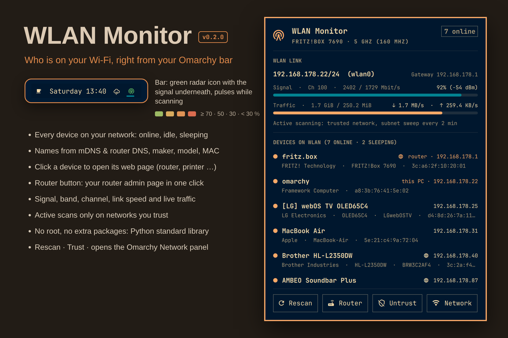

# WLAN Monitor

**See who is on your Wi-Fi from the Omarchy bar, in plain words: every device with a type icon, name, maker and status, names you choose yourself, an alert when a new device joins, collapsible groups (Apple, Android, TV & audio, smart home, …), mesh details for FRITZ!Box (which access point, band, speed and signal), one click to your router's and devices' web pages, plus signal and live traffic.**



WLAN Monitor is a lightweight Omarchy bar widget and popup panel that discovers and lists devices on your local WLAN without requiring root privileges or extra packages.

- **Bar indicator:** a radar chip icon (`󰐻`). Dim while disconnected and green when connected (your theme's green, or a standard green if the theme's "green" is really teal), with a thin signal-quality bar underneath. Hover it for a summary with the device count. It pulses gently while actively scanning the subnet, and a small accent dot appears when a new device joined.
- **Signal in words:** **Excellent** (70 %+, theme green), **Good** (50 %+, yellow), **Fair** (30 %+, orange) and **Weak** (below 30 %, red). Hover the signal bar for dBm, channel and link speed.
- **Detail panel (left click):**
  - **Connection:** this PC's and the router's address, signal in words, and live download / upload. Hover for the technical details (address/prefix, interface, dBm, channel, link speed, session totals).
  - **Devices:** every device on the local subnet with an icon for its type (phone, tablet, laptop, computer, TV, speaker, printer, game console, camera, lighting, storage, appliance, smart-home device, router). Your router and this PC come first, then pinned devices, then online, idle and sleeping ones. Hover the icon for what the status means.
  - **Readable automatic names:** from mDNS / Zeroconf or the router's DNS, tidied up (`PHILIPS_EP8757_20_392985` becomes `Philips EP8757`). A device known only by its maker is shown by type, e.g. `Smart-home device (Espressif)`.
  - **Click a device** for its details in plain words (status explained, maker, model, network name, IP, MAC) and actions:
    - **Rename** it (`Pellet stove` instead of `Microchip Technology device`). The name is tied to the device's hardware (MAC) address on this network, so it stays when the router hands out a new IP. Enter saves, Esc cancels, an empty name restores the automatic one.
    - **Pin to top** or **Hide** (hidden devices are listed again with **Show N hidden**).
    - **Open web page** for the router, devices announcing `_http._tcp` / `_https._tcp` over mDNS, and printer/scanner admin pages (`adminurl`). The `󰖟` icon in the row opens it directly.
  - **New-device alerts (trusted networks):** a desktop notification and a **NEW** badge when a device joins that was never seen on this network before. **It's mine** or **All known** clears them. Devices seen in the first 10 minutes after you trust a network count as known. Turn alerts off with **Alerts on/off**.
  - **Groups (optional):** the switch next to the device header changes between **List**, **Groups by platform** (Favourites, Apple, Android, other phones & tablets, computers, TV & audio, smart home, printers & storage, network & mesh), **Groups by type**, and with FRITZ!Box mesh details **Groups by access point**. Click a group header to collapse or open it; a collapsed group that contains a new device shows a **NEW** badge on its header. The choice is remembered.
  - **Mesh:** the panel shows which router or mesh node this PC is connected to ("Connected via FRITZ!Box 5690 Pro · 6 GHz", found by matching the Wi-Fi BSSID, no login needed). Repeaters and access points are recognised and listed under "Network & mesh". The router is listed under its Wi-Fi name (the one you see in your Wi-Fi settings, e.g. "Router (FRITZ!Box 7690 ML)"); when the real model differs, it is shown below it ("model FRITZ!Box 5690 Pro", read from the FRITZ!Box's public TR-064 description).
  - **FRITZ!Box mesh details (optional login):** **Show mesh details from the FRITZ!Box** asks for a FRITZ!Box user and password once (with an eye icon to show what you typed, and a short help on where to find both). Every device then shows its access point, band (2.4 / 5 / 6 GHz or LAN), speed and signal, devices can be grouped by access point, and devices known only by their maker get the name from the FRITZ!Box. **Disconnect** deletes the stored login.
  - **Search:** with more than 12 devices a search field appears (press `/`), matching name, type, maker, model and IP.
  - **Copy IP / Copy list:** the copy icon copies a device's IP; **Copy list** copies all devices as a Markdown table (via `wl-copy`, no shell).
  - **Rescan**, **Router** (your router's settings page), **Trust / Untrust** (see below) and a Wi-Fi button that opens Omarchy's built-in Network panel.
- **Right click:** triggers an immediate WLAN rescan.

## Trusted networks and scanning

Discovery is **passive** on every network by default: the kernel neighbor table, mDNS announcements and single reverse-DNS lookups for devices that are already visible. Nothing probes the subnet, so the widget behaves well on hotel, café and office Wi-Fi.

Click **Trust** in the panel to allow **active** scanning on the current network (identified by SSID and router MAC address):

- a full sweep every 2 minutes (and when you open the panel, if the last one is older than 30 s): paced ICMP echo to the local `/24` plus a reverse-DNS (PTR) query per address to the router, which also finds sleeping DHCP leases;
- every 15 s a unicast probe of the devices already known, so the online state stays accurate without broadcast ARP traffic.

**Rescan** (or right click) runs one active sweep on demand, on any network. Trusted networks are stored in `~/.config/ubruckhaus-wlan-monitor/trusted-networks.json` (directory `0700`, file `0600`), written only when you click Trust or Untrust.

### FRITZ!Box login

The login is optional and only offered when the router is a FRITZ!Box. Where to find the login:

- There is no fixed default user name. FRITZ!OS before 7.24 asks only for a password; leave the user name empty.
- FRITZ!OS 7.24 and newer: if you never created a user, an update created one named `fritz` plus four random digits (e.g. `fritz1234`). Log in at http://fritz.box and look under System › FRITZ!Box Users.
- Unless you changed it, the password is printed on the label on the bottom or back of the FRITZ!Box (4 to 6 lowercase letters followed by 4 digits).

You can also create a separate FRITZ!Box user with the right "FRITZ!Box settings" (System › FRITZ!Box Users) and keep "Allow access for applications" on (Home Network › Network › Network Settings).

- The user name and password go from the panel to the collector over its stdin pipe (never as command-line arguments) and are saved in `~/.config/ubruckhaus-wlan-monitor/fritzbox.json` (`0600`) only after a successful login. They are never sent back to the panel.
- They are bound to that FRITZ!Box's MAC address and used only with the current gateway when its MAC matches, over TR-064 HTTPS (port 49443) with HTTP Digest authentication, so the password itself is never transmitted.
- The FRITZ!Box certificate is self-signed; its SHA-256 fingerprint is pinned at login. If it changes, nothing is sent and the panel asks you to connect again.
- Reads: `X_AVM-DE_GetMeshListPath` and the mesh list it points to, every 30 s while the panel is open and every 5 minutes otherwise. Replies are size-limited (64 KiB SOAP, 2 MiB mesh list), time-limited (4 s) and every field is validated and sanitized. Nothing is ever changed on the FRITZ!Box.

Device names, pins and hidden flags are stored per network (router MAC + SSID) in `~/.config/ubruckhaus-wlan-monitor/devices.json` (`0600`). On trusted networks the MAC addresses seen there are remembered too, so new devices can be recognised; on other networks only devices you rename, pin or hide are written. The file is bounded (32 networks, 512 devices each) and read with the same checks as the trust list (no symlinks, owned by you, size limit, every field validated).

Optional environment variables for the shell: `WLAN_MONITOR_INTERVAL` (seconds between snapshots while the panel is open, default 3), `WLAN_MONITOR_INTERVAL_CLOSED` (default 6) and `WLAN_MONITOR_FULL_SCAN_EVERY` (full sweep interval on trusted networks, default 120, minimum 30).

## Install

Requires Omarchy's plugin-capable Quickshell and `python3` (standard library only, no extra packages). No setup script or root permissions are needed.

```sh
omarchy plugin add https://github.com/uBruckhaus/omarchy-wlan-monitor
omarchy plugin enable ubruckhaus.wlan-monitor
```

## How it works

A collector (`scripts/wlan-monitor.py`) runs while the widget is loaded and streams one JSON snapshot every 3 s while the panel is open (6 s while closed). The bar widget sends it commands over stdin (`rescan`, `open` / `closed`, `trust` / `untrust`, `known_all`, `fritz_logout`, and one-line JSON: `rename`, `pin`, `hide`, `known`, `alerts`, `view`, `fritz_login`). JSON commands are limited to 1 KiB, need a valid MAC of a device currently listed on this network, and names are cut to 40 printable characters without `<`, `>` or `&`.

- **Light on the system:** routes, signal level and traffic come from `/proc`; `iw` and `ip addr` run only every 12 / 30 s (or when the network changes). All external commands run as fixed argv lists with bounded output and timeouts.
- **Unprivileged local discovery:**
  - Reads the kernel neighbor table (`ip -4 neigh show`). On trusted networks, sends paced unprivileged ICMP echo probes (see above) so online devices show up there.
  - Queries the router's reverse DNS (`PTR` records) over bounded UDP sockets. Replies are only accepted from the router's address and port 53 with a random, outstanding query ID. The router's local domain (e.g. `fritz.box`, `speedport.ip`, `home.arpa`, or one learned from the PTR answers / `resolv.conf`) is removed from names.
  - Reads mDNS / Zeroconf service announcements via `avahi-browse` when available, for human-friendly device names (e.g. TV, soundbar, bridge), model strings and web interfaces.
  - Maps MAC prefixes against the system's local IEEE OUI database (`/usr/lib/udev/hwdb.d/20-OUI.hwdb` or `/usr/share/hwdata/oui.txt`).
- **Network changes:** everything learned (devices, names, caches) is cleared when the interface, gateway, subnet, SSID or router MAC changes, so devices from your home network never appear on another one.
- **New-device notifications** use `notify-send` with a fixed argv; device names in them are sanitized like everywhere else and at most three are listed.
- **Sanitized untrusted text:** All SSIDs, hostnames, mDNS strings and vendor names are stripped of `<`, `>`, `&` and control characters before output, and all QML `Text` items render in `Text.PlainText` mode.
- **Safe web links:** web UI URLs are built only from the device's private IPv4 address inside the local subnet, a numeric port and a plain path (`[A-Za-z0-9._~/-]`, no `..`). Advertised services are offered only after a TCP connect check succeeds. The panel checks the URL shape again and opens it in your default browser with `omarchy-launch-browser` as a single argument, with no shell.

## Update or remove

```sh
omarchy plugin update ubruckhaus.wlan-monitor
```

```sh
omarchy plugin disable ubruckhaus.wlan-monitor
omarchy plugin remove ubruckhaus.wlan-monitor
```

The plugin creates no services. The only files outside its folder are the trusted network list, the device names and view settings, and the optional FRITZ!Box login in `~/.config/ubruckhaus-wlan-monitor/`. Delete that directory to remove them.

## Development

```sh
python3 scripts/wlan-monitor.py --once | python3 -m json.tool
python3 -m unittest discover -s tests -v
omarchy plugin validate .
```

Licensed under [MIT](LICENSE).
